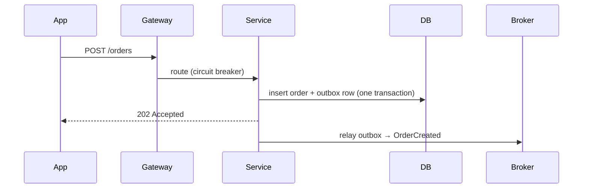
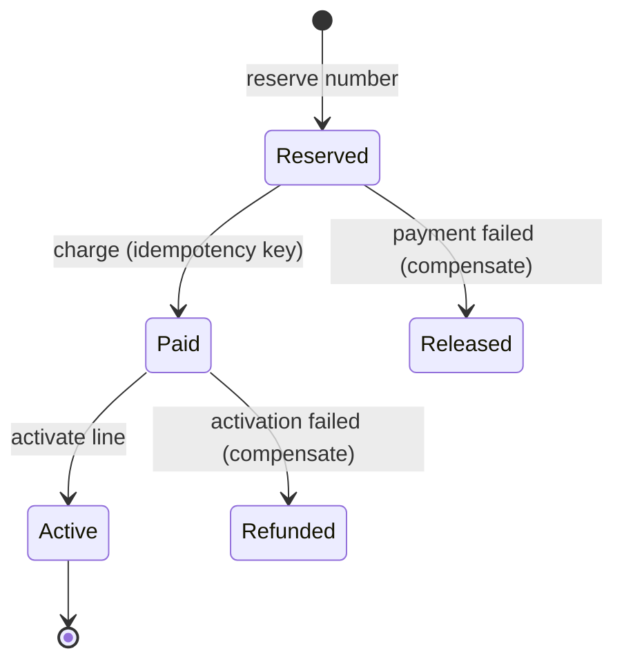

The "Where we use it" columns are this workspace's to fill: a `repo:path` where the pattern already runs, so the
architect reuses before adding. Keep it true as work items land.

## How to choose

Work through these in order and write the answers into `plan.md` under "Architecture choices". Every row where you
picked one option over another is a proposed ADR (`/adr`).

1. **What crosses a boundary?** List each call between components (apps, gateways, services, providers).
   For each: does the caller need the answer to continue (synchronous), or only that it will happen (asynchronous)?
2. **Consistency.** Must two services change together, or can one catch up? If they must change together, you need
   a saga or must keep both changes in one service (no shared tables).
3. **Failure.** What happens when the other side is slow or down? Every external provider needs timeouts, retries
   and a circuit breaker. Name the fallback the customer sees.
4. **Load and latency.** Expected requests per second, peaks (campaigns, month start), and the latency budget.
5. **Ownership.** Which team owns each component; a pattern that spreads one change over three teams needs a reason.
6. **Existing or new.** For existing code, prefer the strangler fig or an anti-corruption layer over a rewrite
   (and keeps new logic out of legacy systems). For new work, start with the simplest style that meets 1 to 4.
7. **Constitution check.** The architecture rules in `constitution/L2-architecture.md` and the invariants in `constitution/L1-invariants.md`
   hold whatever you pick.
   A choice that should bind every team becomes an amendment through `/amend` (a pull request).

Default when nothing above pushes elsewhere: synchronous REST through the gateway for reads and commands that need an
answer; an event on the broker for "this happened" that other services react to; the outbox whenever a database change
and an event must not drift apart.

## Communication styles

| Style | Use when | Avoid when | Trade-off | Where we use it |
|---|---|---|---|---|
| **REST (synchronous)** | The caller needs the answer now; reads; commands with an immediate result. | A chain of three or more services in one request; slow providers in the customer's path. | Simple and debuggable; couples availability (if B is down, A fails). | _fill in_ |
| **Events (publish / subscribe)** | Something happened and several services may react; the publisher must not know them. | The publisher needs a result; ordering across entities matters and the broker cannot keep it. | Loose coupling and independent scaling; eventual consistency, harder tracing. | _fill in_ |
| **Message broker / work queue** | Work that can wait, retries with back-off, smoothing peaks, one consumer per message. | Request/response disguised as a queue; tiny volumes where a direct call is clearer. | Durability and retries; a broker to run, dead letters to watch. | _fill in_ |
| **CQRS** | Reads and writes have very different shapes or loads (reporting, search, dashboards). | Plain CRUD; one team, small data. | Fast reads; two models to keep in step (usually through events). | _fill in_ |

Broker choice: use what the platform already runs for the service family. A new broker type is an ADR and a request
to the platform team, not a design detail.

## Integration and distributed-transaction patterns

| Pattern | Use when | Avoid when | Where we use it |
|---|---|---|---|
| **Saga, orchestrated** | A business process spans services and needs compensation (order → payment → fulfilment → notification); one place should own the state. | Two steps in one service; a single database transaction would do. | _fill in_ |
| **Saga, choreographed** | Few steps, each service reacts to the previous event, no central owner needed. | More than three or four steps (the flow becomes invisible). | _fill in_ |
| **Transactional outbox** | A database change and the event about it must both happen or neither (audit, idempotency). | No event is published. | _fill in_ |
| **Idempotent consumer** | Any consumer of a broker or a retried request (always). | — | _fill in_ |
| **API gateway** | One entry for app traffic: routing, auth, rate limits, versioning. | Business logic in the gateway. | _fill in_ |
| **Backend for frontend (BFF)** | One client needs a shaped API (mobile screens) that would bloat the shared one. | A BFF per screen. | _fill in_ |
| **Sidecar** | Cross-cutting runtime needs beside a container without changing it (log shipping, proxies, certificates, legacy protocol bridges). | Business logic; anything the platform chart already provides. | _fill in_ |
| **Ambassador** | A local proxy that handles a provider's quirks (auth, retries, mTLS) for a service that cannot. | The service can use a normal client with resilience. | _fill in_ |
| **Strangler fig** | Replacing part of a legacy system route by route behind the gateway or proxy. | A greenfield service. | _fill in_ |
| **Anti-corruption layer** | New code must talk to a legacy or provider model it should not adopt (a legacy core, a provider's codes). | The models already match. | _fill in_ |

## Resilience

| Pattern | Rule here | Where we use it |
|---|---|---|
| **Timeout** | Every outbound call has one, shorter than the caller's. | _fill in_ |
| **Retry with back-off** | Only for idempotent calls; capped; jitter. Never retry a charge without an idempotency key. | _fill in_ |
| **Circuit breaker** | Every external provider; a clear fallback message for the customer. | _fill in_ |
| **Bulkhead** | Separate pools for slow providers so one cannot starve the rest. | _fill in_ |
| **Cache-aside** | Read-heavy reference data (catalogue, configuration) with a clear expiry and invalidation. | _fill in_ |

## What each pattern needs downstream

| Pattern | Diagram in `/design` | Tests in `/test` | Deploy in `/deploy` |
|---|---|---|---|
| REST | sequence per endpoint | contract test against the OpenAPI file | gateway route |
| Events / broker | event flow: topic, producer, consumers, dead letter | publish and consume test; schema test against `contracts/` | queue and dead-letter config, alerts on the dead-letter count |
| Saga | state diagram with each compensation | one test per compensation path; timeout of each step | process definition version, how in-flight instances migrate |
| Outbox | sequence: transaction, outbox row, relay, broker | crash between commit and publish still publishes once | relay job, its lag alert |
| Idempotency | — | the same request twice changes state once | — |
| Circuit breaker | where it sits on the sequence | open, half-open and fallback behaviour | thresholds by configuration name |
| Sidecar / ambassador | deployment diagram with the pod | the main container works when the sidecar restarts | chart values, resources for both containers |
| Strangler fig | before and after routing | the same request answered the same by old and new | routing flag, rollback by flipping it |

## Diagram templates

Write diagrams as Mermaid in the phase's diagram file (see "Diagrams" in the phase commands). Two starting points:

