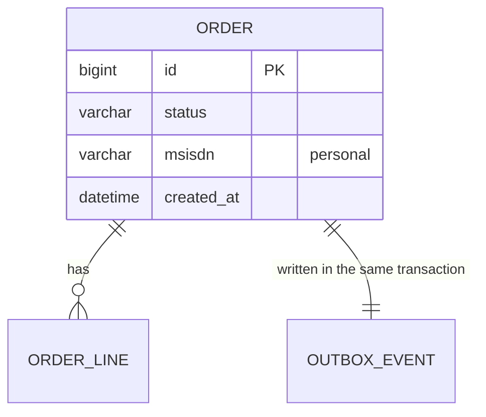

## Rules that always hold

- Each service owns its schema. No service reads or writes another service's tables; share through an API or
  an event (`architecture-patterns`).
- **No production personal data on a laptop.** Local stores use masked restores; agents count personal columns, never
  return them (the workspace's database skill, if it has one).
- **Data residency.** Customer data of a market stays where that market's regulator requires; a store in another
  country or a global cloud region is an ADR with the legal basis named, never a design detail.
- **Configuration by name** : connection strings and credentials come from the secret store; `docs/env-catalog/`
  lists the names.

## Step 1: what the data is

For each entity in `data-model.md` write: owner service, personal-data class (none, personal, sensitive), volume and
growth, read/write ratio, the queries it must answer (by key, by range, full text, joins, aggregates), consistency
needed (strong within the service, eventual across), retention and deletion, and audit needs .

## Step 2: the store

| Need | Choose | Not | Where we have it |
|---|---|---|---|
| Transactions across several tables, joins, reporting, constraints | **Relational** | Key-value for relational data | _fill in_ |
| Look-ups by one key at high volume, flexible attributes, no joins | **Key-value / document** | When the queries are not known yet: start relational | _fill in_ |
| Short-lived data, sessions, rate limits, read-heavy reference data | **Cache** (Redis), always with a source of truth behind it | As the only copy of anything | _fill in_ |
| Free-text search, faceted filters | **Search index** fed from the source of truth | As the system of record | _fill in_ |
| Append-only facts, audit, event history | Relational with partitioning, or the analytics store the platform provides | Updating rows in place | _fill in_ |

Engine for a **new** relational store: what the platform provides for new services (its catalogue and ADRs). An engine
the platform does not run yet is an ADR.

## Step 3: cloud managed or on-premises

| Question | Points to managed cloud | Points to on-premises / in-cluster |
|---|---|---|
| Where must the data live? | A cloud region in the market's country is allowed | Regulator or contract requires the operator's data centre |
| Who runs backups, patching, failover? | We want the provider to | The platform team already runs it for us |
| Latency to the callers | Callers are in the same cloud | Callers are in the data centre |
| Cost shape | Spiky or small | Steady and large |

Ask the platform team first (its catalogue of managed and in-cluster databases). Write the choice and the residency basis as an ADR.

## Step 4: schema, migrations, change

- Migrations live with the service, are versioned, and each says whether it is reversible; destructive changes go in
  two releases (expand, then contract).
- Every change to a customer, line, order or payment is audited : who, what, when, channel.
- Personal columns are named in `data-model.md` with their class, retention and who may read them.

## Moving between engines

Between relational engines: one build that runs on both engines behind a provider setting, the same tests on both,
data copied and verified before the switch. Relational to NoSQL or back: an ADR that names the queries the new store must answer, a dual-write or change-data-capture period, and a
comparison check before the old store is retired.

## Diagrams for /design

An entity diagram of the service's own tables (Mermaid `erDiagram`), and a data-flow diagram showing which service
owns which store and how data moves between them (API, event, replication), with personal data marked.

