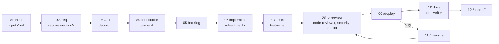

# Examples — the agentic engineering loop, worked end to end

> This example predates `specs/` (template v2). Its steps still hold; in v2 the
> feature-level work lands in `specs/<KEY>-<slug>/` through `/intent`, `/spec`,
> `/design`, `/tasks`, `/build`, `/test`, `/deploy` instead of `docs/requirements/`
> and `planning/BACKLOG.md`, which stay for product-wide requirements.

One fictional feature, **buy a data add-on** in a telecom self-care app, taken through every step of the loop this template supports. Each file shows what the engineer types, what Claude (or the named agent) does, the file it produces, and what to check before moving on. Copy the produced files into your own project's paths; the names and IDs are examples.

The example system is generic on purpose: a mobile app (Swift / Kotlin), an API gateway (Ruby), a core service (.NET), a notification service (Java), a billing system (BSS) and a payment gateway. No real company, product or data appears here.

| Step | File | Command / agent | Produces |
|---|---|---|---|
| 01 | [01-input-prd.md](data-addon/01-input-prd.md) | read + summarise | `inputs/prd/<date>-data-addon.md` (never edited) |
| 02 | [02-requirements.md](data-addon/02-requirements.md) | `/req`, requirements-keeper | `docs/requirements/v1-<date>.html`, `register.yaml` |
| 03 | [03-adr.md](data-addon/03-adr.md) | `/adr`, adr-writer | `docs/adr/0001-<slug>.md` |
| 04 | [04-constitution.md](data-addon/04-constitution.md) | `/amend` | `constitution/L1–L3`, `AMENDMENTS.md` |
| 05 | [05-backlog.md](data-addon/05-backlog.md) | plan | `planning/BACKLOG.md` |
| 06 | [06-implementation.md](data-addon/06-implementation.md) | code, `.claude/rules/`, `verify` skill | code under `code/<service>/` |
| 07 | [07-tests.md](data-addon/07-tests.md) | test-writer | tests per requirement ID |
| 08 | [08-pr-review.md](data-addon/08-pr-review.md) | `/pr-review`, code-reviewer, security-auditor | findings + merge verdict |
| 09 | [09-deploy.md](data-addon/09-deploy.md) | `/deploy` | deploy report with URL |
| 10 | [10-docs.md](data-addon/10-docs.md) | doc-writer | `outputs/developer-guide/`, `outputs/api/` |
| 11 | [11-fix-issue.md](data-addon/11-fix-issue.md) | `/fix-issue` | failing test, fix, commit with root cause |
| 12 | [12-handoff.md](data-addon/12-handoff.md) | `/handoff` | `HANDOFF.md` |

## How to use it in a workshop

1. Create a project from this template (see the root `CLAUDE.md`).
2. Put the PRD from step 01 into `inputs/prd/`.
3. Run each step's prompt in order and compare what Claude produces with the expected output in the file. Differences are the discussion.
4. The hooks fire on their own: `session-start` shows the latest requirements and ADRs, `prompt-router` reminds you to use `/req` or `/adr`, `protect-published-versions` blocks edits to a committed version.
