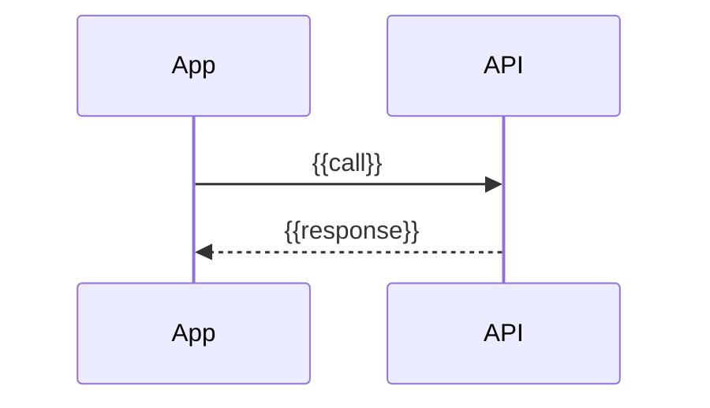

# Design — {{KEY}} {{TITLE}}

**Status:** draft
**Spec:** [spec.md](spec.md)

## Approach
{{One paragraph: how the requirements are met and why this way.}}

## Components touched
| Repo | Component | Change | Requirements | Rules file |
|---|---|---|---|---|
| {{repo}} | {{module / screen / endpoint}} | {{add / change / remove}} | {{R1, R2}} | `.claude/rules/{{file}}.md` |

## Sequence

## Contracts
OpenAPI and event schemas live in [contracts/](contracts/). List each one and whether it is new or changed.

## Data
See [data-model.md](data-model.md).

## Configuration
Names only, never values. Values come from the local `.env` or the secret store.

| Name | Repo | Purpose | Local value |
|---|---|---|---|

## Feature flags
| Flag | Default | Removed when |
|---|---|---|

## Decisions
| ADR | Title | Status |
|---|---|---|

## Risks
| Risk | Mitigation |
|---|---|

## Rollout and rollback
{{Order of deploys, flag strategy, migration order, how to roll back.}}

## Test strategy
Summary only; the mapping is in [test-plan.md](test-plan.md).

## Change log
| Date | Change | Why | Approved by |
|---|---|---|---|
